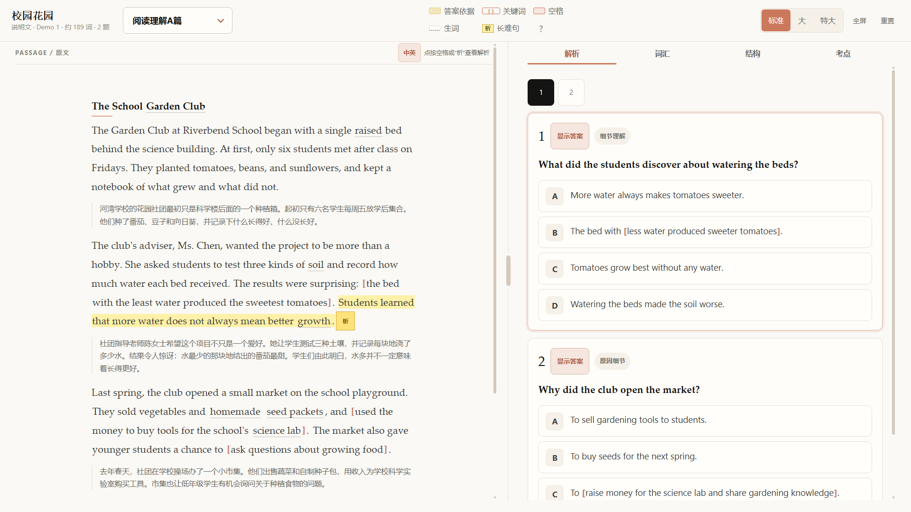
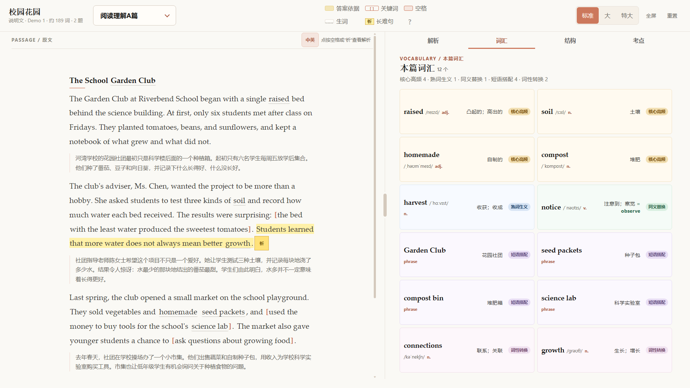

<div align="center">

# MrLiHua · 李华同学

**把英语试卷变成可讲解、可触摸、可离线运行的交互解析页。**

一个面向高中英语课堂的 DSH Skill：阅读 A–D、七选五、完形填空、语法填空，最终生成一个无需后端、无需联网的单文件 HTML。

`v1.0.0` · `Windows 10 + Edge` · `4K touch-first` · `MIT`

</div>



> 截图使用仓库自带的**合成演示**，不含任何真实试卷、学校或学生数据。

### 词汇：12 个/篇，五类胶囊标签



- **核心高频**：高考 3500 重点实词（琥珀色）
- **熟词生义**：reserve、present、plain 等“认识但考偏”的词（深蓝色）
- **同义替换**：明确写出可替换词，如 `reserve = book`（翠绿色）
- **短语搭配**：be subject to、follow through、first come first serve（紫色）
- **词性转换**：confirm → confirmation、pollinate → pollinators（紫罗兰）
- 右栏宽度变化时自动 1 / 2 / 3 列；点词查看考点、替换词、派生链、例句与例句翻译。

---

## 它是什么

MrLiHua 不是一个在线刷题网站，而是一条“试卷 → 结构化数据 → 单文件课堂页”的离线流水线。

老师把试卷照片和答案放在本机，运行构建脚本，得到：

- 一个可以直接双击打开的 `.html`；
- 左右分栏：左侧原文 / 右侧解析；
- 答案默认隐藏，点击题号旁“显示答案”再展开；
- 原文依据滚动定位，高亮以 0.5 秒从左向右展开；
- 每篇独立词汇表、结构图、主旨链、高频考点；
- 中英对照、关键句翻译、长难句结构、生词抽屉；
- 适配希沃 4K 触摸大屏：48–56px 热区、无外部依赖。

## 核心特性

| 能力 | 说明 |
|---|---|
| 单文件离线 | HTML/CSS/JS 全部内联，`file://` 直接打开 |
| 答案控制 | 默认隐藏；逐题显示 / 隐藏；七选五选项库不提前泄题 |
| 证据链 | 选项 → 原文依据 → 同义 / 反义 / 改写 / 逻辑关系 |
| 高亮动画 | 先滚动到段落，滚动停止后内联背景 0.5s 从左向右展开；多行不靠绝对定位 |
| 中英对照 | 逐段中文；关键句 / 证据句附翻译；可切“仅英文” |
| 长难句 | 主干、层次、指代、翻译，点击“析”打开抽屉 |
| 课堂工具 | 解析 / 词汇 / 结构 / 考点四个下划线标签页 |
| 词汇分类 | 12 个/篇；五类胶囊标签；1/2/3 列自适应；考点 / 同义替换 / 派生 / 例句翻译 |
| 4K 触摸 | 大字号、宽间距、双行顶部信息、48–56px 控件 |
| 数据校验 | 引文、题号、选项、答案、词汇锚点构建前校验 |

## 快速开始

### 1. 构建仓库自带演示

```powershell
python -m pip install -r requirements.txt
python scripts/validate_exam.py examples/demo/demo_exam.json
python scripts/build_exam.py examples/demo/demo_exam.json -o examples/demo/demo_exam.html
```

双击 `examples/demo/demo_exam.html`，或：

```powershell
start examples/demo/demo_exam.html
```

### 2. 作为 DSH Skill 安装

把本仓库复制到 DSH skills 目录：

```powershell
Copy-Item -Recurse . "$env:USERPROFILE\.dsh\skills\english-exam-reader"
```

然后在 DSH 中调用 `english-exam-reader`。具体工作流、硬规则和 4K 规范见 [SKILL.md](SKILL.md)。

### 3. 做自己的试卷

1. 按 [references/schema.md](references/schema.md) 准备 `exam.json`；
2. `python scripts/validate_exam.py exam.json`；
3. `python scripts/build_exam.py exam.json -o output.html`；
4. 用 Edge 打开 `output.html`。

图片预处理：

```powershell
python scripts/prepare_images.py .\photos --rotate --split --trim
```

## 界面

- **解析**：逐题卡片、答案、依据、选项判断、错因、方法提示；
- **词汇**：当前篇独立词表，点击打开音标、搭配、例句、相关考点；
- **结构**：结构图、主旨链、一句话主旨、逻辑提示；节点可点击定位原文；
- **考点**：高频考点卡，点击定位对应段落。

顶部为单行导航：文章信息、题型下拉、两行图例、字号 / 全屏 / 重置。没有 Logo 和独立品牌行，尽量把高度留给内容。

## 目录

```text
.
├─ SKILL.md                  # DSH skill 主流程与硬规则
├─ assets/
│  ├─ app.css                # 4K / 触摸 / 分栏 / 标签页 / 高亮
│  └─ app.js                 # 交互、答案控制、滚动与动画
├─ scripts/
│  ├─ build_exam.py          # JSON → 单文件 HTML
│  ├─ validate_exam.py       # 构建前数据校验
│  └─ prepare_images.py      # 手机照片预处理
├─ templates/shell.html      # HTML 外壳
├─ references/               # schema / analysis / extraction / design
├─ examples/demo/            # 合成演示（可公开）
└─ docs/
   ├─ screenshot-1920.png    # 解析界面
   └─ screenshot-vocab-1920.png  # 词汇分类界面
```

## 本机接口与隐私

- **没有后端、没有端口、没有数据库**；
- **没有网络请求**：无 `fetch` / XHR / WebSocket / beacon；
- **没有 CDN、外部字体、统计脚本或第三方 SDK**；
- HTML/CSS/JS 全部内联，`file://` 即可运行；
- 浏览器只使用 `localStorage["exam-font-size"]` 记住字号，不存储试卷内容；
- 构建脚本只读本地文件，图片预处理使用 Pillow，不联网；
- 公开仓库不包含真实试卷、答案、学校或学生数据。

完整审计见 [SECURITY.md](SECURITY.md)。

## 浏览器与设备

- Windows 10/11 + Microsoft Edge / Chromium；
- 1920×1080 与 3840×2160；
- 触摸优先，兼容鼠标；
- 全屏使用浏览器 Fullscreen API，需要用户手势。

## AI 披露

本项目的代码、样式、文档、测试脚本与演示中文翻译在开发过程中使用了 AI 辅助，详见 [AI_DISCLOSURE.md](AI_DISCLOSURE.md)。

运行时**不调用任何 AI 服务**，也不会上传试卷。

## 许可

[MIT](LICENSE) © 2026 salicylate350234（MrLiHua / 李华同学）

## 版本记录

见 [CHANGELOG.md](CHANGELOG.md)。当前版本：**v1.0.0**。

## 联系

- GitHub：[@salicylate350234](https://github.com/salicylate350234)
- 问题与建议：请在本仓库开 [Issue](https://github.com/salicylate350234/MrLiHua/issues)

> MrLiHua 是独立项目，不隶属于任何学校、考试机构或出版社。  
> 请只处理你拥有使用权或已获授权的试卷内容；公开或商用前请自行确认版权与隐私要求。
